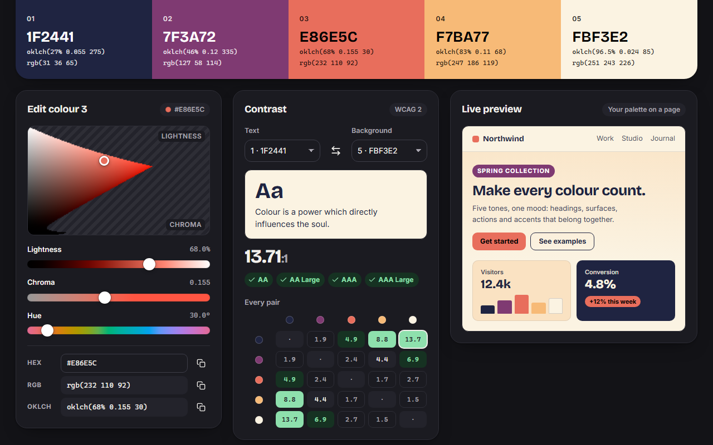

# Palette Lab



Palette Lab generates harmonious five-colour palettes in the OKLCH colour space and helps you turn them into
something you can ship.

- **Generate** a palette with <kbd>Space</kbd> or the Generate button. Pick a harmony (analogous, complementary,
  triadic, split complementary, monochrome) or leave it on Auto.
- **Lock** the colours you like; the next palettes are built around the first locked colour's hue.
- **Edit** any colour on a lightness × chroma plane at its hue, with OKLCH sliders whose tracks show the real
  colours, or by typing a hex value (`#rgb`, `#rrggbb`; an alpha part is ignored). Colours outside sRGB are mapped
  to the nearest displayable chroma, keeping lightness and hue. A grey keeps the hue it had, so adding chroma back
  does not jump to red.
- **Read** every colour as HEX, RGB and OKLCH, and copy any value.
- **Check contrast** between any two colours (or white and black) with the WCAG 2 ratio and AA/AAA badges for body
  and large text, plus a matrix of every pair. Ratios are cut down, never rounded up, so a pair that fails never
  shows a passing number.
- **Preview** the palette on a small example page: the darkest colour becomes text, the lightest the page, the most
  colourful of the rest the primary action.
- **Export** as CSS custom properties, JSON, a Tailwind config or a Tailwind v4 `@theme` block.
- **Share** the palette: the URL hash always holds the colours, the locks and the harmony.
- Undo and redo, light and dark themes (following the system until you pick one), works from 320 px wide.

Everything runs in the browser and nothing is sent anywhere. The browser's `localStorage` keeps your theme choice
(`palette-lab:theme`) and your last palette with its locks (`palette-lab:palette`), so reopening the app without a
link brings them back. A link always wins over the saved palette. The Palette Lab name at the top left starts again
from the example palette (Undo brings yours back).

## Keyboard

| Key | Does |
| --- | --- |
| <kbd>Space</kbd> | New palette |
| <kbd>1</kbd>–<kbd>5</kbd> | Pick a colour to edit |
| <kbd>L</kbd> | Lock or unlock the picked colour |
| <kbd>C</kbd> | Copy the picked colour's hex |
| <kbd>Ctrl</kbd>/<kbd>⌘</kbd>+<kbd>Z</kbd> | Undo |
| <kbd>Ctrl</kbd>/<kbd>⌘</kbd>+<kbd>Shift</kbd>+<kbd>Z</kbd> or <kbd>Ctrl</kbd>+<kbd>Y</kbd> | Redo |

Shortcuts do nothing while you type in a field or a list is focused. <kbd>Space</kbd> works wherever else the
focus is, also right after you click a colour, except on a button, link or tab you reached with the keyboard:
there it presses that control, as usual. In the HEX field, <kbd>Enter</kbd> applies the value and <kbd>Esc</kbd>
puts the current colour back.

## Run it

```sh
npm ci
npm run dev      # local development server
npm test         # unit tests (Vitest)
npm run lint     # oxlint
npm run build    # type-check and build to dist/
npm run preview  # serve dist/
```

Node 22 or newer.

## How it works

- `src/color.ts`: sRGB ⇄ linear ⇄ OKLab ⇄ OKLCH conversions, gamut mapping by chroma reduction, WCAG 2 relative
  luminance, contrast ratio and how ratios are shown.
- `src/generate.ts`: palette generation. Colours run from a deep shade to a pale tint; chroma peaks in the middle
  tones; hues follow the chosen harmony rule. A seeded PRNG keeps it testable.
- `src/roles.ts`: which colour plays which part in the live preview.
- `src/share.ts`, `src/storage.ts`, `src/export.ts`: the URL hash format, the saved palette and theme, and the
  export formats.
- `src/history.ts`: undo and redo. A state equal to the current one is not recorded, so every undo changes
  something.
- `src/keyboard.ts`: the shortcuts and when Space belongs to the focused control.
- `src/main.ts` wires the page together: the swatches, generation, history and the link. `src/editor.ts`,
  `src/contrast-panel.ts` and `src/export-panel.ts` each run one panel; `src/state.ts` holds the shared state.
- `tests/`: unit tests for the conversions, contrast and its display, gamut mapping, generation, roles, the hash,
  saving, the theme, history, shortcuts and exports.

`icon.svg` is the app's icon in listings and also its favicon: the build copies it into `dist/assets/`.

Screenshots: [dark theme](docs/screenshot-dark.png) (editor, contrast checker, live preview) and [light theme](docs/screenshot-light.png) (live preview and the Tailwind v4 export). `docs/icon.png` is a 512 px render of `icon.svg`.

## Sources and licences

- OKLab conversion matrices: Björn Ottosson, "A perceptual color space for image processing" (2020), the same
  values used by the W3C CSS Color Module Level 4 specification.
- WCAG 2 contrast formula: W3C Web Content Accessibility Guidelines 2.2, success criteria 1.4.3 and 1.4.6.
- Fonts: Inter and Bricolage Grotesque, bundled through `@fontsource-variable` packages, SIL Open Font License 1.1.
- Icons: shapes adapted from Lucide (ISC License), some of them from Feather (MIT License).
- The example palette and the preview copy were written for this app.

The licence texts for the fonts and icons ship with the app in
[`public/THIRD_PARTY_NOTICES.txt`](public/THIRD_PARTY_NOTICES.txt), linked from the page footer.

## Licence

MIT, © 2026 iSquare Lab. See [LICENSE](LICENSE).
